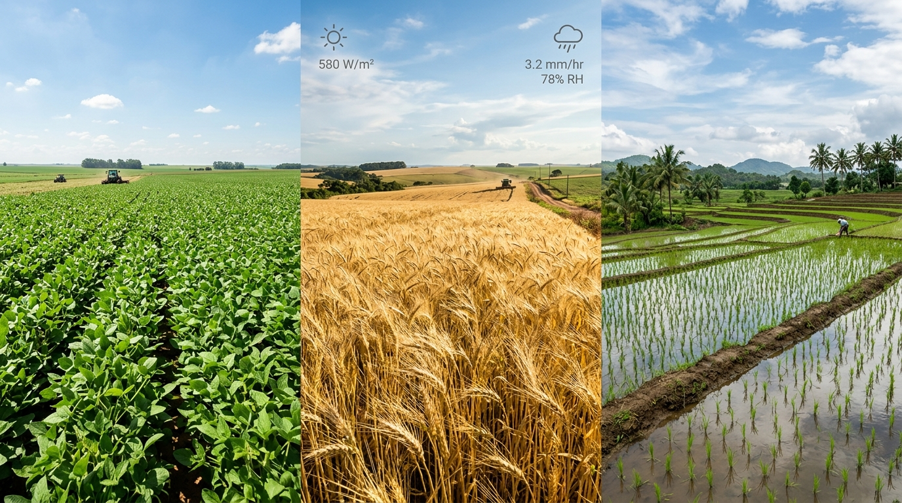
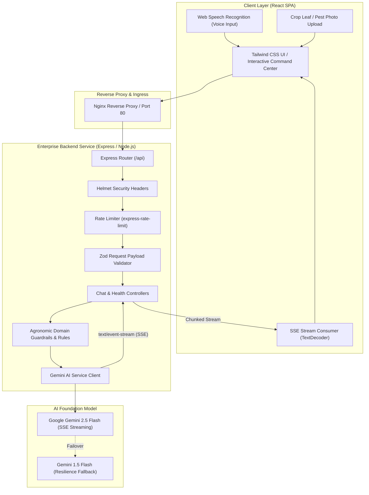

# 🌾 AgroAssist — Enterprise AI Agronomy Advisory Platform

[](https://github.com/Samith-45/agroAssist/actions/workflows/ci.yml)
[](https://nodejs.org/)
[](https://react.dev/)
[](https://expressjs.com/)
[](https://ai.google.dev/)
[](LICENSE)

AgroAssist is an enterprise-grade, full-stack digital agronomy system designed to empower farmers, agronomists, and agricultural extension officers with real-time, domain-guardrailed crop advisory services. Powered by Google Gemini 2.5 Flash multimodal vision and Server-Sent Events (SSE) streaming, the platform delivers visual leaf disease diagnostics, interactive NPK fertilizer calculators, soil pH calibration, and seasonal crop scheduling across multiple regional languages.


---

## 📸 Visual Project Overview & Core Modules

| 🔬 1. AI Computer Vision Pathology | 🧪 2. Smart Soil & NPK Telemetry | 🌦️ 3. Seasonal & Drip Crop Planner |
| :---: | :---: | :---: |
|  |  |  |
| **Multimodal Leaf & Pest Scanner:** Detects foliar chlorosis, fungal blight, rust pustules, and viral leaf curling from uploaded or drag-and-dropped field photos with confidence metrics and organic/chemical protocols. | **Interactive 4R Nutrient Calculator:** Computes exact per-acre Urea, DAP, and MOP fertilizer dosages with real-time soil pH acidity/alkalinity remediation badges (Lime vs. Gypsum). | **Agro-Climatic Zone Modeling:** Matches drought-tolerant Kharif, Rabi, and Zaid crop varieties to regional soil types (Black Vertisols, Alluvial, Red Loam) and optimizes drip irrigation. |

---

## 🏛️ System Architecture



---

## 🚀 Key Engineering Highlights

- **Zero-Exposure Secrets Architecture**: Direct client-side calls to generative AI providers are eliminated. All requests traverse an authenticated backend proxy insulating the `GEMINI_API_KEY`.
- **Low-Latency SSE Streaming**: Token streaming via HTTP Server-Sent Events (`text/event-stream`) providing instantaneous visual response deltas to the farmer.
- **Multimodal Plant Pathology**: Supports base64/MIME-validated leaf and pest photography for automated disease diagnosis (chlorosis, rust, blight, pests) with confidence metrics.
- **Domain Guardrails**: Strict agronomic system instructions preventing hallucination and enforcing adherence to agricultural sciences (soil pH, Kharif/Rabi/Zaid seasonality, NPK ratios, eco-friendly bio-pesticides).
- **Graceful Lifecycle Management**: Server features zero-downtime container termination (`SIGTERM`/`SIGINT`), uncaught exception handlers, and container health probes (`/health`, `/ready`).
- **Containerized Microservices**: Fully orchestrated Docker Compose setup with multi-stage builds, non-root user execution, and Nginx caching/reverse proxying.

---

## 📂 Repository Structure

```text
agroAssist/
├── .github/
│   └── workflows/
│       └── ci.yml               # Automated GitHub Actions test & build pipeline
├── backend/                     # Node.js / Express Enterprise Service
│   ├── src/
│   │   ├── config/              # Zod-validated environment configuration
│   │   ├── constants/           # Agronomy system prompts & domain guardrails
│   │   ├── controllers/         # Chat, streaming, and observability handlers
│   │   ├── middleware/          # Rate limiting, validation, error handling
│   │   ├── routes/              # Modular API routes
│   │   ├── services/            # Gemini client & streaming generator
│   │   ├── app.js               # Express application composition
│   │   └── server.js            # HTTP server entrypoint & graceful shutdown
│   ├── tests/                   # Automated node:test integration suite
│   ├── Dockerfile               # Production multi-stage Alpine container
│   ├── package.json             # Backend dependencies & test scripts
│   └── .env.example             # Backend environment template
├── frontend/                    # Modern React 18 Single Page Application
│   ├── src/
│   │   ├── components/          # ChatContainer, Chat, LeftNav, Mobile drawer
│   │   ├── utils/               # AppContext and secure API streaming client
│   │   ├── Page/                # Page layouts (Home)
│   │   ├── App.js               # Root component
│   │   └── index.css            # Tailwind CSS typography & custom scrollbars
│   ├── public/                  # Static assets & web manifest
│   ├── Dockerfile               # Multi-stage Nginx production container
│   ├── package.json             # Frontend client dependencies
│   └── .env.example             # Frontend environment template
├── docker-compose.yml           # Unified multi-container orchestration
├── .dockerignore                # Container build exclusions
├── .gitignore                   # Comprehensive root git exclusions
└── README.md                    # Master technical documentation
```

---

## 🛠️ Tech Stack Matrix

| Layer | Technologies | Purpose |
| :--- | :--- | :--- |
| **Frontend** | React 18, Tailwind CSS, React Markdown | Responsive agronomy advisory interface |
| **Audio & Vision** | Web Speech Recognition API, Base64 File API | Hands-free farmer voice input & leaf photo capture |
| **Backend** | Node.js (v20+ ESM), Express.js | High-concurrency API gateway & streaming proxy |
| **AI / LLM** | `@google/generative-ai`, Gemini 2.5 Flash | Multimodal agricultural inference & guidance |
| **Security** | Helmet, express-rate-limit, Zod | Secret masking, DDoS protection, input validation |
| **DevOps** | Docker, Docker Compose, Nginx, GitHub Actions | Containerization, reverse proxying, and automated CI |

---

## ⚡ Quick Start Guide

### Option 1: Docker Compose (Recommended)

1. **Clone the repository:**
   ```bash
   git clone https://github.com/Samith-45/agroAssist.git
   cd agroAssist
   ```

2. **Configure environment:**
   ```bash
   cp backend/.env.example backend/.env
   # Edit backend/.env and paste your GEMINI_API_KEY
   ```

3. **Launch the stack:**
   ```bash
   docker compose up --build
   ```
   - **Frontend UI:** [http://localhost:3000](http://localhost:3000)
   - **Backend API:** [http://localhost:5000](http://localhost:5000)
   - **Health Probe:** [http://localhost:5000/health](http://localhost:5000/health)

---

### Option 2: Native Local Development

#### Prerequisites
- Node.js `v20.x` or higher
- npm `v10.x` or higher
- Gemini API Key ([Google AI Studio](https://aistudio.google.com/))

#### 1. Backend Setup
```bash
cd backend
cp .env.example .env
# Set GEMINI_API_KEY in .env
npm install
npm test           # Execute automated integration tests
npm run dev        # Starts server on http://localhost:5000 with watch mode
```

#### 2. Frontend Setup
```bash
cd ../frontend
cp .env.example .env
npm install
npm start          # Starts React dev server on http://localhost:3000
```

---

## 🔌 API Reference

### 1. `POST /api/chat/stream`
Streams AI agronomic advice via Server-Sent Events (SSE).

**Request Headers:**
```http
Content-Type: application/json
```

**Request Payload:**
```json
{
  "history": [
    {
      "text": "What is the recommended fertilizer schedule for wheat?",
      "isBot": false
    }
  ],
  "imageInput": {
    "inlineData": {
      "mimeType": "image/jpeg",
      "data": "<BASE_64_ENCODED_STRING>"
    }
  }
}
```

**Stream Response (`text/event-stream`):**
```text
data: {"chunk":"For optimal wheat yield, "}

data: {"chunk":"apply N-P-K at a 4:2:1 ratio during sowing and tillering..."}

data: [DONE]
```

---

### 2. `GET /api/crops/suggestions`
Retrieves curated farm query prompts categorized by agronomic discipline.

**Response:**
```json
{
  "categories": [
    {
      "id": "diagnostics",
      "label": "Disease & Pest Diagnostics",
      "description": "Upload leaf or pest photos for visual AI inspection",
      "prompt": "Identify this symptom and suggest cultural and organic remedies:"
    }
  ]
}
```

---

### 3. `GET /health` & `GET /api/ready`
Observability probes for container readiness and liveness checks.

**Response:**
```json
{
  "status": "ready",
  "checks": {
    "geminiConfigured": true,
    "memoryHeapUsedMB": 38
  },
  "uptimeSeconds": 142,
  "environment": "production"
}
```

---

## 🧪 Testing & Quality Gates

The backend includes automated integration testing using Node's native test runner (`node:test`):

```bash
cd backend
npm test
```

Pipeline outputs verify:
- Liveness `/health` and Readiness `/api/ready` probes
- Crop category recommendation data contract
- Strict 400 Bad Request rejection on malformed JSON / schemas

---

## 🔒 Security Best Practices

- **Principle of Least Privilege**: Containers execute under an unprivileged `node` user.
- **Input Sanitization & Schema Validation**: Payloads are strictly parsed using Zod to block prototype pollution and payload tampering.
- **CORS Allowlist**: Cross-Origin Resource Sharing is locked to configured client origins (`ALLOWED_ORIGINS`).
- **Rate Limiting**: Chat endpoints enforce window-based request throttling (`100 req / 15 min`) to avoid upstream quota exhaustion.

---

## 📄 License
This project is licensed under the [MIT License](LICENSE).
